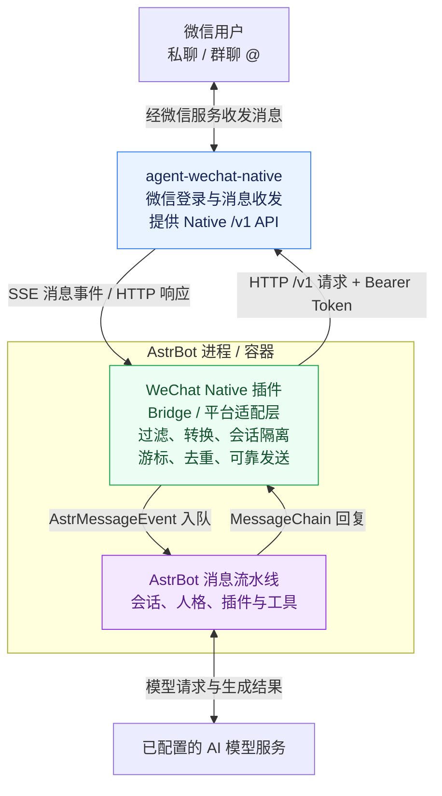
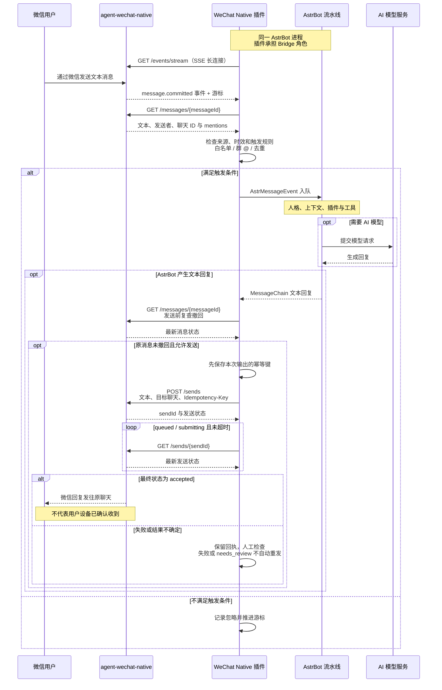

# WeChat Native

让 AstrBot 直接通过 **agent-wechat-native `/v1` API** 接入个人微信。

- GitHub 项目：`astrbot-plugin-wechat-native`
- AstrBot 插件 ID：`astrbot_plugin_wechat_native`
- 显示名称：**WeChat Native**，作者：**neozhu**
- Python **3.12+**；优先兼容 **AstrBot 4.29.3**、**agent-wechat-native v1.2.0**

这是运行在 AstrBot 内部的 **Platform Adapter Plugin**，无需额外 Python Bridge，
无需 AstrBot OpenAPI Key，不修改 AstrBot 核心。消息交给 AstrBot 正常流水线处理，
可使用已配置的 AI 模型、人格、插件与工具。

首版支持文本私聊、群聊 @回复、白名单、独立会话、SSE 重连、持久化去重和发送回执。
图片、语音、文件及原生引用回复尚未实现；不支持的输出组件会明确报错，不会假装发送成功。
请关闭此机器人的文本转图片功能。流式模型输出会汇总为文本后发送。

## AstrBot、Bridge 与 agent-wechat 的关系

这里说的 **Bridge（桥接）由 WeChat Native 插件承担**：它作为平台适配层加载在 AstrBot 内部。
部署时运行 **AstrBot + agent-wechat-native**，在 AstrBot 中安装本插件即可。



| 部分 | 负责什么 | 在哪里配置 |
| --- | --- | --- |
| **AstrBot** | 消息处理、AI 模型调用、人格、上下文、插件和工具 | AstrBot 的模型与配置文件界面 |
| **WeChat Native 插件（Bridge 角色）** | 把微信消息转换为 AstrBot 事件，把 AstrBot 回复转换为 Native 请求；管理白名单、会话、游标、去重和发送回执 | AstrBot 的 WeChat Native 机器人配置界面 |
| **agent-wechat-native** | 维护微信登录与连接，执行实际微信收发，提供 `/v1` API 和 SSE 事件 | Native 服务端的登录与账号配置 |

用户在机器人配置中填写的 **server_url、account_id 和 token / token_file 都指向 Native**。
其中 `account_id` 是 Native 管理的账号 ID，Token 是 Native API 的访问凭据；
AI 模型凭据由 AstrBot 的模型配置管理，本插件不需要 AstrBot OpenAPI Key。
若使用 Docker 端口映射或反向代理，它们只负责让 AstrBot 能访问 Native 地址。

## 一条微信消息如何得到回复

下图中的插件和 AstrBot 流水线位于同一个进程；Native 是独立的微信服务。
为便于阅读，`/events/stream`、`/messages/{messageId}` 和 `/sends` 均省略共同前缀
`/v1/accounts/{accountId}`。



**接收靠 SSE 通知，完整内容再通过 HTTP 读取；回复由 AstrBot 生成，通过 Native 发回原聊天。**
群聊默认只接受 Native 明确标记的 `mentions.state == "known"` 且 `mentions.self == true`，
并在首个成功发送的回复片段中 @原发送者。插件同时隔离会话、保存事件游标并去重；
发送结果不确定时保留原幂等键与回执供检查，避免自动重复回复。

页面中的“测试连接”走另一条更短的只读路径：
**连接测试卡片 → AstrBot 插件 Web API → Native `/v1/status` → Native 账号状态**。
它确认服务可达、认证有效及微信在线，不会向模型提问或发送微信消息。

## 安装

以下安装方式适用于已将这些文件发布到 GitHub 默认分支的仓库；本地开发完成不会自动推送代码。

1. 在 Native v1.2.0 中完成账号登录；确认 Native API 从 **AstrBot 所在的容器/主机**可达。
2. 打开 AstrBot **插件管理 → 从链接安装**，填写：
   `https://github.com/neozhu/astrbot-plugin-wechat-native`。
3. 安装并启用插件。若机器人类型列表尚未刷新，刷新页面或重启 AstrBot。
4. 在 **机器人 → 新增机器人** 中选择 **WeChat Native**，填写连接信息并启用。
5. 为该机器人选择 AstrBot 配置文件，设置模型与人格。为模型/工具配置权限的方式与其他平台相同。

仓库的 `main.py`、`metadata.yaml` 和 `requirements.txt` 直接位于根目录。
AstrBot 会安装运行依赖；不要在生产 AstrBot 中安装 `requirements-dev.txt`。

## 机器人配置

| 字段 | 含义与默认值 |
| --- | --- |
| `server_url` | Native 根地址或以 `/v1` 结尾的地址，必填；可使用任意可达 HTTP(S) 地址，也支持反向代理路径前缀 |
| `account_id` | `GET /v1/accounts` 返回的账号 `id`，必填；不是微信号 |
| `token` | Native Bearer Token；界面以秘密字段显示，但仍存于 AstrBot 配置文件中 |
| `token_file` | **优先于 token** 的只读文件路径；必须在 AstrBot 容器内可读；末尾换行自动去除 |
| `enable_private_reply` | `true`，允许私聊自动回复 |
| `allowed_users` | 私聊 `senderId` 白名单；空列表允许所有用户；不限制群成员 |
| `group_reply_mode` | `mention`（默认）：仅明确 @自己；`all`：所有群文本；`disabled`：关闭群聊 |
| `allowed_groups` | 群 `threadId` 白名单（通常为 `…@chatroom`）；空列表允许所有群 |
| `unique_session` | `true`：同群不同成员独立会话；`false`：同群共享会话 |

推荐填 `token_file`、使用限定该账号且仅有 **read + send** 权限的 Native Token。
Token 文件在插件启动时读取，轮换后重启机器人。不要把 Token 放进 URL，不要提交真实配置。
本插件不需要 Native 登录、管理、媒体或 read-state 权限，也不自动标记聊天已读。

私聊只接受 `incoming` 文本；忽略自己发送的消息。
默认群模式严格要求 `mentions.state == "known"` 且 `mentions.self == true`。
手打 `@名字`、未知 mentions、仅 @全体都不会触发默认群回复。
群回复的首个成功片段默认通过 Native 的 `mentions.userIds` @原发送者，后续片段不自动重复 @；
插件输出的显式 @始终保留，每个片段发送前仍会复查原消息是否撤回。
对于 Native 明确标记为 known/self 的群消息，行首以 U+2005 分隔的 @昵称前缀会从
AstrBot 使用的文本中移除，使 `@机器人 /help` 能正常匹配指令；原始正文保留在 raw_message。
手打的普通 @字符串、未知 mentions 和正文中间的 @不做该处理。
`all` 模式会加入供 AstrBot 唤醒阶段识别的 At 组件；它是策略唤醒标志，真实 mentions 保留在 raw_message。
AstrBot 自身的全局白名单、唤醒词、模型启用开关和插件权限仍然生效。

会话 ID 包含账号、聊天类型、threadId；群成员独立模式还包含 senderId，并逐段 URL 编码。
AstrBot 的机器人实例 ID 进一步隔离不同机器人。主动发送可使用事件的 `unified_msg_origin`。
不要修改实例 ID 或 Native 地址来尝试恢复旧会话/回执，这会创建另一份状态。

## 连接测试小卡片

更新并重载插件后，进入 **插件管理 → WeChat Native 插件详情 → 可视化视图 → 连接测试**。
先在原有机器人配置界面保存 Native 地址、Account ID 和 Token / token_file。
卡片读取已保存的配置，未启用或启动失败的微信机器人也可检测；多个机器人时可用下拉框选择。

页面打开后检测一次；点击 **测试连接** 或切换机器人可再次检测。检测中按钮和选择框暂时禁用，
不自动轮询，也不订阅 SSE。Native API 验证成功后，连接状态显示绿色 **已连接**，
微信在线状态单独显示 **在线 / 离线**。微信未登录或掉线时保留已连接状态，并显示具体原因；
网络、认证或账号验证失败才显示红色 **连接失败**。
修改配置后先保存，再点击测试；新增机器人后可刷新视图更新列表。

后端通过 `context.register_web_api()` 注册只读 GET 接口，按顺序读取 Native
`/v1/status` 和 `/v1/accounts/{accountId}`。只确认服务就绪、认证有效、账号匹配且在线；
**不发送微信消息、不修改游标或去重状态，也不验证模型、SSE 收信或发送权限**。
检测使用独立的短连接客户端，不影响正在运行的机器人连接。
每次检测重新读取已保存配置和 Token 文件；浏览器只得到机器人 ID、检测状态和安全的失败原因，
不接收 Token、Token 路径、Native 原始响应或账号详情。

常见失败原因：Token 无效/权限不足、API 地址或 Account ID 不存在、服务不可达/超时、
账号尚未登录或离线。连接正常后仍需按文末清单由账号所有者完成真实收发验收。

## Docker 网络与 Token 挂载

`127.0.0.1` 始终指向**发起请求的容器本身**。AstrBot 和 Native 不在同一网络命名空间时，
`http://127.0.0.1:6174` 无法指向另一个 Native 容器。

推荐让两个容器加入同一个 Docker 网络，使用 Native 服务名，例如：
`http://wechat-native:6174`。也可使用实际已发布的宿主机端口或内网转发地址。
例如 `http://10.33.1.150:6175` **只有在该转发/端口发布已启用时才可用**；插件不会创建转发。
不要仅因 Native 宿主机上的 localhost 能访问，就认定 AstrBot 容器也能访问。

Token 文件若只在 Native Docker 宿主机的 `/opt/agent-wechat-native/api-token`，
需由管理员安全挂载到 AstrBot 容器，例如在 AstrBot 服务的 Compose 配置中添加：

```yaml
volumes:
  - /opt/agent-wechat-native/api-token:/run/secrets/wechat_native_token:ro
```

随后把机器人 `token_file` 填为 `/run/secrets/wechat_native_token`。
确认容器运行用户有读取权限；不要为了方便将文件权限设为全员可读。
该示例只声明路径，不包含密钥，也不表示开发环境可访问该宿主机。

插件使用 aiohttp 直接访问所配服务，不使用进程的 HTTP_PROXY，避免内网请求误走外部代理。
HTTP 会明文传输 Token；跨不可信网络请使用 HTTPS 或受保护隧道。TLS 校验保持开启。
反向代理必须允许长连接并关闭 SSE 缓冲；Native 每约 15 秒发送心跳，插件 45 秒无数据后重连。
HTTP 重定向被拒绝，避免 Bearer Token 被发送至意外目标。

## 消息可靠性及状态

插件自动在 AstrBot 的 `data/plugin_data/astrbot_plugin_wechat_native/` 下创建 SQLite 状态库，
按服务地址、账号及机器人实例 ID 分离。不需要手工创建文件。
请持久挂载 AstrBot 的 `data` 目录并保护其权限。运行中备份数据库需使用 SQLite backup，
不要只复制主文件而忽略 WAL。

- SSE 订阅 `/events/stream`，以保存的十进制字符串游标通过 `after` 和 `Last-Event-ID` 恢复。
- 每次连接核对 `/v1/status.serverId`，Native 数据目录被重建或同地址更换服务时停止并保留原状态，不能静默沿用旧游标。
- `message.committed` 后读取 `/messages/{messageId}`，核实账号、聊天和消息标识，再交给 AstrBot。
- 只接受 `origin == "live"` 且消息时间在当前时间前 **5 分钟内**（允许 60 秒未来时钟误差）的文本。
  历史导入、未知来源、过旧积压、非文本和撤回消息不触发 AI。请同步两台机器的时钟。
  实时消息因时间异常被忽略时，每个机器人最多每分钟警告一次，仅记录时间差，不输出正文和身份。
- 相同本地消息 ID 的 threadId/serverId 若发生变化，会明确停止并保留 `needs_review` 供人工检查，首版不自动接纳复用标识。
- 消息 ID 去重和游标在同一 SQLite 事务提交。重复/忽略消息也会推进游标。
- 撤回事件会停止仍持有的 AstrBot 事件；发送前重新读取原消息，发现撤回则不再回复。
  已在生成中的模型调用/外部工具操作不能回滚，发送前检查与 Native 接受发送之间也无法完全消除竞态。
- 每个输出先持久记录唯一 `Idempotency-Key` 再提交 **一次** POST。
  超时/5xx 后仅按原 key 查询回执，不重复 POST；`queued/submitting` 有限轮询，
  `accepted` 才标记成功。它只表示微信服务端接受，不证明对方设备已收到。
  回执 GET 遇到临时网络故障、408/429 或 5xx 时，在原截止时间内继续查询同一 send_id。
  客户端尚未连接时会在本地拒绝发送，不创建未知回执；429 后查无回执仍保留不确定状态。
- `needs_review`、失败、取消、回执不匹配、无法查询结果都不会自动重发。
  一条输入的任一片段发送失败后，后续发送会停止，避免在同一响应中制造重复或部分续发。

**队列消费与失败边界：** AstrBot 内部队列没有跨插件的事务确认接口，因此不能承诺端到端 exactly-once。
消息交付队列后记为 `queued`（已交给 AstrBot，尚未确认回复）；回复成功后记为 `replied`。
明确调用发送但输出为空时记为 `no_reply`，重启不会转为待核查；之后仍允许该事件产生非空回复。
若该事件随后开始真实发送，会与发送记录在同一事务中恢复为 `queued`，避免崩溃后误显示无需回复。
发送失败保留 `failed` 或 `needs_review`；已有片段成功、后续片段失败或未确认时记为 `partial`，
每段原始回执仍保留在 sends 表，后续自动续发会被阻止。撤回为 `recalled`；过滤为 `ignored`。
重启时会结合未确认的发送记录恢复 `partial`；已经出现失败或取消后，即使在途片段的成功回执
稍后到达，也不会解除后续发送门控。`replied` 表示已有片段确认成功，不代表流水线已全部完成。
重启时尚为 `queued` 的记录转为 `needs_review`，**不会重新交给模型或重发**。
这也包括正常流水线选择不回复、模型失败、进程在交付窗口崩溃等情况，需结合 AstrBot 日志判断。
游标提交失败前的事件会重放；已交付但未确认回复的消息不会悄悄被视为成功。

状态库只存消息/聊天/服务端标识、游标、幂等键与回执状态，**不存聊天正文和 Token**。
这些标识仍属私人数据，请勿公开状态库。首版不自动删除去重记录，磁盘占用随消息量增加。
本插件日志不输出聊天正文或 Token；AstrBot 核心/其他插件自己的会话日志不受本插件控制。

### 排查未确认回复（只读）

在 AstrBot 宿主机本地检查状态库，不要上传：

```bash
sqlite3 -readonly /path/to/state.sqlite3 \
  'SELECT id,status FROM messages WHERE status IN ("queued","needs_review","failed","partial");'
sqlite3 -readonly /path/to/state.sqlite3 \
  'SELECT key,state,send_id FROM sends WHERE state != "accepted";'
```

有 send_id 时读取 Native `GET /v1/accounts/{accountId}/sends/{sendId}`；
也可用 `GET /v1/accounts/{accountId}/sends/by-idempotency-key?key=原键` 查询。
使用安全的本地凭据方式请求，勿把 Token 放进聊天、脚本仓库或终端录屏。
确认 Native 回执及真实聊天后再由人决定是否补发；不要删除状态库或换 key 来自动“修复”。
插件不提供自动重试不确定业务动作的按钮。

## 本地开发与自动测试

```bash
python3.12 -m venv .venv
. .venv/bin/activate
python -m pip install -r requirements-dev.txt
python -m playwright install --with-deps chromium
python -m pytest -q
ruff check .
ruff format --check .
python -m compileall -q main.py adapter.py config.py event.py native_client.py state.py connection_view.py
```

开发依赖锁定官方 AstrBot 4.29.3 源码提交；测试使用真实 AstrBot 类和 loopback aiohttp 模拟服务，
覆盖认证与路径编码、SSE 分帧/游标恢复/重连、白名单、群 @门控、会话隔离、去重、撤回和发送回执。
不需要真实微信账号或 Token，不会向真实微信发送消息。连接测试页面另用 Chromium 测试自动检测、重试和多机器人选择（仅替换 Dashboard bridge）。
GitHub Actions 执行同样的检查。若系统已安装 `chromium`，测试优先使用系统浏览器；
Playwright 仅属于开发依赖，安装插件时不需要浏览器或前端构建。
Python 3.12 下 AstrBot 的音频依赖可能产生 `audioop` 弃用提示，与文本适配器无关。

## 真实环境验收清单（须由账号所有者执行或明确授权）

自动测试通过不代表已做真实微信收发。先用只读请求核对连接与登录，再人工发送测试消息。

- [ ] 从 AstrBot 容器验证配置地址可达；`GET /v1/accounts` 能列出预期账号，且 Account ID 正确。
- [ ] `GET /v1/accounts/{accountId}` 返回对应 id、`authenticated: true`、`connection: online`。
- [ ] 在 AstrBot 界面启用机器人，确认 SSE 保持连接，无 401/403 或游标过期错误。
- [ ] 白名单用户私聊发一条文本，验证模型、人格/指令插件和单次回复；自己发出的回复不再次触发。
- [ ] 群里普通文本、手打 @名字不触发；真正 @机器人可回复并 @原发送者；未知 mentions 不触发。
- [ ] 验证私聊开关、用户/群白名单、群 disabled/all 和群成员独立会话配置。
- [ ] 短暂断开网络后恢复，验证新消息处理一次；超过 5 分钟的积压不会突然触发回复。
- [ ] 消息在回复前撤回，不再发送；needs_review 只保留回执、不自动重复发送。
- [ ] 重启/禁用机器人，确认连接及时关闭，持久状态保留，重新启用后没有重复回复。

## 常见问题

**没有 WeChat Native 机器人类型？** 确认插件安装成功并启用；看插件依赖错误，刷新页面或重启。
必须使用支持动态平台注册配置的 AstrBot 4.29.3；其他版本尚未独立验证。

**401/403？** 检查 Token 文件容器路径/读取权限、Token 是否过期，以及是否允许该账号的 read/send。
这是 Native Token，与 AstrBot OpenAPI Key 无关。

**私聊无回复？** 确认配置了可用模型，私聊开关与白名单允许；消息应为新鲜 incoming/live 文本。
检查 AstrBot 自身唤醒/全局白名单/插件流水线。插件会保留未确认处理记录。

**群 @不触发？** 使用微信的真正 @功能，不是手打字符串；Native 必须返回 known/self true。
确认群白名单与 mention 模式。@全体默认不触发。

**event_cursor_expired / HTTP 410？** 插件停止而不会擅自跳过消息。
停止机器人、备份状态后，由管理员核对 Native 事件保留范围并决定恢复策略。
首版没有自动回填/重置游标工具，不应通过删除状态库绕过去重。

**连接拒绝或超时？** 检查容器网络、端口发布、防火墙和 SSE 代理设置。
内网转发端口必须实际启用；配置 IP 不会自动启动转发。

**发送 needs_review？** 微信可能已收到，只是确认丢失。保留原 key/send_id 并按上文只读检查，勿盲目重发。
单条文本不能超过 64 KiB（Native 的限制包含最终 @名称）；首版超长回复报错，不静默截断。

## 协议依据与许可证

独立依据官方接口实现，未复制或改编第三方微信适配器代码，沿用本仓库 MIT 许可证（见 LICENSE）。
AstrBot 和 Native 的许可证及运行条件由各自项目规定。

- [AstrBot v4.29.3 平台接口](https://github.com/AstrBotDevs/AstrBot/tree/v4.29.3/astrbot/core/platform)
- [AstrBot 官方适配器文档](https://github.com/AstrBotDevs/AstrBot/blob/main/docs/zh/dev/plugin-platform-adapter.md)
- [Native v1.2.0 API](https://github.com/thisnick/agent-wechat/blob/v1.2.0/docs/src/content/docs/use/api.mdx)
- [Native v1.2.0 mentions](https://github.com/thisnick/agent-wechat/blob/v1.2.0/docs/src/content/docs/use/mentions.mdx)
- [Native v1.2.0 发送与恢复](https://github.com/thisnick/agent-wechat/blob/v1.2.0/docs/src/content/docs/how-it-works/sends.mdx)

请遵守相关服务条款并评估个人账号使用风险，仅接入有权操作的账号。
