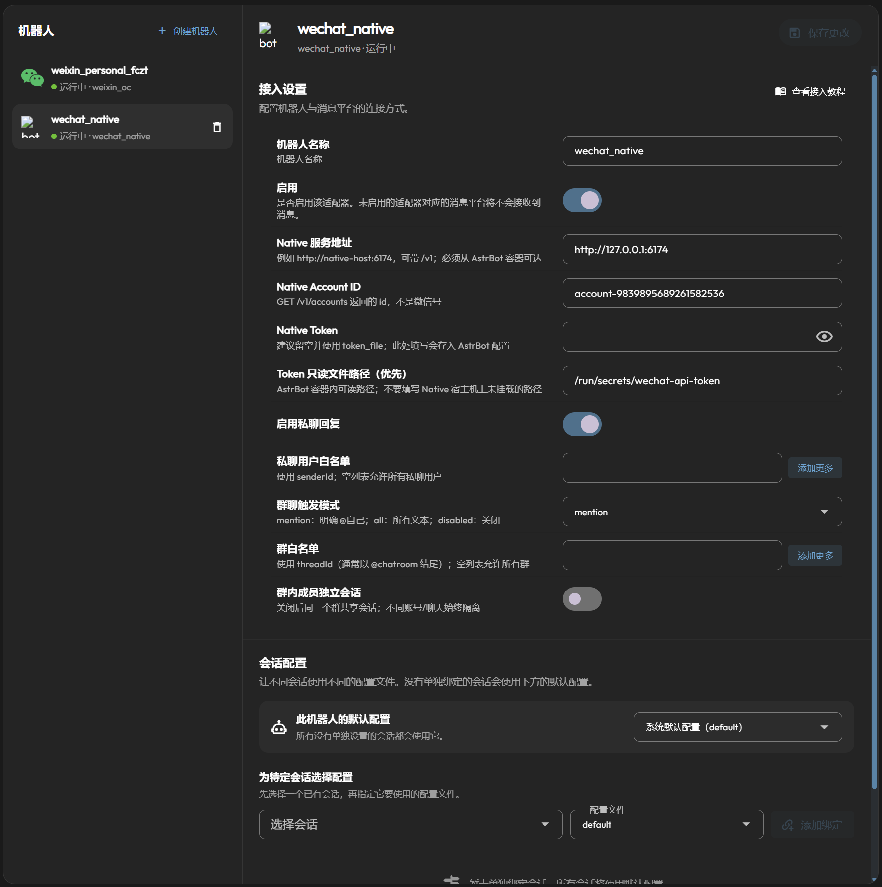

# WeChat Native

让 AstrBot 通过 **agent-wechat-native /v1 API** 接入个人微信。插件装在 AstrBot 内，不需要额外 Bridge 服务。

支持文本私聊、群聊 @回复、白名单、独立会话、断线重连和持久化去重。
暂不支持图片、语音、文件及原生引用回复；请关闭该机器人的**文本转图片**功能。

适配版本：**AstrBot 4.29.3、Native v1.2.0**；插件运行需要 **Python 3.12+**。

## 安装与配置

1. 启动 Native 并登录微信；全新 Docker 部署按下一节操作。
2. 在 AstrBot **插件管理 → 从链接安装**，输入：
   `https://github.com/neozhu/astrbot-plugin-wechat-native`。
3. 在 **机器人 → 新增机器人** 中选择 **WeChat Native**，填写下表并启用。
4. 为机器人选择 AstrBot 配置文件，配置模型和人格，再测试私聊及群 @回复。

参数配置示例（Account ID 和开关以实际使用为准）：



### 连接信息

以下字段填写在 AstrBot 的机器人表单中，**不是 Native 的 server.toml 配置**。

| 字段 | 填写说明 | 本文 Docker 示例 |
| --- | --- | --- |
| `server_url` | AstrBot 能访问的 Native 地址，可带 `/v1` | `http://127.0.0.1:6174` |
| `account_id` | Native 的账号 `id`，从 `wx accounts list` 获取；不是微信号 | 替换为实际 ID |
| `token_file` | Token 文件的**容器内路径**，优先于 `token` | `/run/secrets/wechat-api-token` |
| `token` | 不用文件时填写 Native API Token，会保存在 AstrBot 配置里 | 使用文件时留空 |

Native Token 需要目标账号的 **read + send** 权限。本文 Compose 让两个容器读取同一份 Token 文件。
模型 API Key 在 AstrBot 的模型设置中配置；更换 Token 文件后重启机器人。

### 回复规则

| 字段 | 默认值 | 说明 |
| --- | --- | --- |
| `enable_private_reply` | `true` | 是否回复私聊 |
| `allowed_users` | `[]` | 私聊 senderId 白名单；空列表允许所有人，不限制群成员 |
| `group_reply_mode` | `mention` | `mention`：真正 @机器人；`all`：全部群文本；`disabled`：不回复群聊 |
| `allowed_groups` | `[]` | 群 threadId 白名单，通常以 `@chatroom` 结尾；空列表允许所有群 |
| `unique_session` | `true` | 同群不同成员独立会话；关闭后同群共享会话 |

用户 ID 和群 ID 可用 Native 的 `wx contacts find 名字`、`wx chats list` 查询。
手打 `@名字` 或仅 @全体不会触发默认群回复。分段回复仅首段自动 @原发送者，插件显式输出的 @仍保留。
AstrBot 的模型开关、全局白名单和插件权限仍需正确配置。

## Docker 部署：同一台 Linux 主机

需要 Docker Compose 和 OpenSSL。已有部署请在**原 Compose 项目**中修改，保留项目名和数据卷。

两个服务都使用 **host 网络**，因此 AstrBot 可通过 `http://127.0.0.1:6174` 访问 Native，
不配置 `ports`。Native 的默认监听地址也保持为本机地址。

### 1. 准备 Native 配置和 Token

全新部署时先创建工作目录及配置目录：

```bash
mkdir -p wechat-bot
cd wechat-bot
sudo mkdir -p /opt/agent-wechat-native
sudoedit /opt/agent-wechat-native/server.toml
```

在 `server.toml` 中写入：

```toml
schemaVersion = 1
listen = "127.0.0.1:6174"
dataDir = "/var/lib/agent-wechat"
tokenFile = "/run/secrets/wechat-api-token"
```

生成 Token 并设置权限。**已有 Token 会保留，不要覆盖正在使用的凭据。**
Native 容器用户为 UID/GID `10001`；Token 文件保持 `600`，只读挂载。

```bash
sudo sh -c '
  umask 077
  test -f /opt/agent-wechat-native/api-token ||
    openssl rand -hex 32 > /opt/agent-wechat-native/api-token
'
sudo chown 10001:10001 /opt/agent-wechat-native/api-token
sudo chmod 600 /opt/agent-wechat-native/api-token
sudo chmod 644 /opt/agent-wechat-native/server.toml
```

### 2. 创建 compose.yaml

```yaml
services:
  astrbot:
    image: soulter/astrbot:latest
    container_name: astrbot
    restart: unless-stopped
    network_mode: host

    environment:
      TZ: Asia/Shanghai

    volumes:
      - astrbot_data:/AstrBot/data
      - /opt/agent-wechat-native/api-token:/run/secrets/wechat-api-token:ro

    logging:
      driver: json-file
      options:
        max-size: "10m"
        max-file: "3"

  agent-wechat:
    image: ghcr.io/thisnick/agent-wechat-native:v1.2.0
    container_name: agent-wechat
    restart: unless-stopped
    network_mode: host
    user: "10001:10001"
    read_only: true

    cap_drop:
      - ALL

    security_opt:
      - no-new-privileges:true

    environment:
      TZ: Asia/Shanghai
      TMPDIR: /var/cache/agent-wechat

    tmpfs:
      - /tmp:rw,noexec,nosuid,size=64m,mode=1777

    volumes:
      - agent_wechat_native_data:/var/lib/agent-wechat
      - agent_wechat_native_scratch:/var/cache/agent-wechat
      - /opt/agent-wechat-native/server.toml:/etc/agent-wechat/server/config.toml:ro
      - /opt/agent-wechat-native/api-token:/run/secrets/wechat-api-token:ro

    stop_grace_period: 30s

volumes:
  astrbot_data:
  agent_wechat_native_data:
  agent_wechat_native_scratch:
```

`astrbot_data` 保存 AstrBot 配置、会话及插件回执，`agent_wechat_native_data` 保存 Native 账号和登录状态；
升级时保留它们。不要用 `docker compose down -v` 删除登录数据。
`agent_wechat_native_scratch` 是临时快照空间，需要预留磁盘容量。
若自行将 AstrBot 改为非 root 用户，还需保证该用户可读挂载的 Token 文件。

### 3. 启动服务并登录微信

```bash
docker compose config --quiet
docker compose up -d
docker compose logs --tail=50 agent-wechat astrbot
```

首次在 Native 容器内登记本机服务，并查询账号：

```bash
docker compose exec agent-wechat wx config server add local --url http://127.0.0.1:6174 --token-file /run/secrets/wechat-api-token
docker compose exec agent-wechat wx --server-name local accounts list
```

没有账号时创建一个，再按提示扫码或在手机确认。已有账号时使用原账号，不要重复创建。

```bash
docker compose exec agent-wechat wx --server-name local accounts create --alias me
docker compose exec agent-wechat wx --server-name local --account me auth login
docker compose exec agent-wechat wx --server-name local accounts list
```

记下返回的账号 `id`。如需使用已有官方微信资料，按
[Native 登录说明](https://github.com/thisnick/agent-wechat/blob/v1.2.0/docs/src/content/docs/setup/connect.mdx)
挂载资料目录；使用期间保持官方客户端关闭。

### 4. 配置 AstrBot 机器人

打开 `http://宿主机IP:6185`，按启动日志中的初始凭据登录并修改密码。
安装本插件后，在 WeChat Native 机器人表单中填写：

- `server_url`：`http://127.0.0.1:6174`
- `account_id`：上一步返回的实际账号 ID
- `token_file`：`/run/secrets/wechat-api-token`
- `token`：留空

宿主机文件是 `/opt/agent-wechat-native/api-token`，**机器人必须填挂载后的容器内路径**。
确认 AstrBot 版本符合插件要求，配置好模型并启用机器人。管理面板 6185 仅向管理网络开放，Native 6174 保持本机访问。

### 5. 检查连接

进入 **插件管理 → WeChat Native → 可视化视图 → 连接测试**：
“已连接”表示 Native API 验证通过；“在线 / 离线”单独表示微信账号状态。
检测不发送消息，也不验证模型和发送权限，最后还需人工测试私聊及群内真正 @回复。

排查网络时，可从 AstrBot 容器执行只读检查，不输出 Token：

```bash
docker compose exec -T astrbot python - <<'PY'
import json
from pathlib import Path
from urllib.request import Request, urlopen

token = Path("/run/secrets/wechat-api-token").read_text().strip()
req = Request("http://127.0.0.1:6174/v1/status",
              headers={"Authorization": "Bearer " + token})
with urlopen(req, timeout=5) as response:
    print("Native 服务状态:", json.load(response).get("state"))
PY
```

### 其他网络环境

- **Windows / macOS Docker Desktop**：本例的 host 网络需先在设置中启用，文件权限也需按宿主环境调整；见 [Docker host 网络说明](https://docs.docker.com/engine/network/drivers/host/)。
- **Native 在另一台主机**：填 AstrBot 实际可达的 HTTPS 地址或加密隧道入口；Token 文件需在 AstrBot 所在主机另行准备并挂载。
- **AstrBot 使用 bridge 网络**：容器里的 `127.0.0.1` 指向它自己。只加入同一网络或增加端口映射，不能让 Native 的 loopback 监听自动对外可达，需提供受保护的可达入口。

跨主机使用 HTTPS 或受保护隧道；反向代理需关闭 SSE 缓冲并允许长连接。

## 常见问题

| 现象 | 检查方法 |
| --- | --- |
| 没有 WeChat Native 类型 | 确认插件启用、AstrBot 版本符合要求，刷新页面或重启 |
| 401 / 403 | 检查 Native Token、账号范围及 read/send 权限 |
| Token 文件不可读 | 核对容器内路径、挂载文件是否存在、运行用户权限 |
| 连接拒绝 / 超时 | 从 AstrBot 容器检查地址、网络模式和 Native 是否启动 |
| API 已连接，微信离线 | 在 Native 完成登录或等待账号恢复连接 |
| 在线但不回复 | 检查模型、白名单和群触发模式；历史或超过 5 分钟的消息会被忽略，注意时钟同步 |
| `needs_review` / `partial` | 保留回执，先核对真实聊天；不要自动重发或删除状态库 |
| HTTP 410 / 游标过期 | 停止机器人并备份状态，由管理员核对 Native 事件保留范围 |

插件状态位于 `/AstrBot/data/plugin_data/astrbot_plugin_wechat_native/`。
请保留整个 AstrBot data 目录；发送回执、重启恢复和只读排查见 [运维说明](docs/operations.md)。

## 开发与协议

```bash
python -m pip install -r requirements-dev.txt
python -m playwright install chromium
python -m pytest -q
ruff check .
ruff format --check .
```

使用 Python 3.12 虚拟环境；生产安装由 AstrBot 处理 `requirements.txt`，无需安装开发依赖。

- [AstrBot Docker 部署](https://docs.astrbot.app/deploy/astrbot/docker.html)
- [Native Docker 部署](https://github.com/thisnick/agent-wechat/tree/v1.2.0/deploy/native)
- [Native v1.2.0 API](https://github.com/thisnick/agent-wechat/blob/v1.2.0/docs/src/content/docs/use/api.mdx)

本插件采用 [MIT 许可证](LICENSE)。仅接入有权操作的微信账号。
