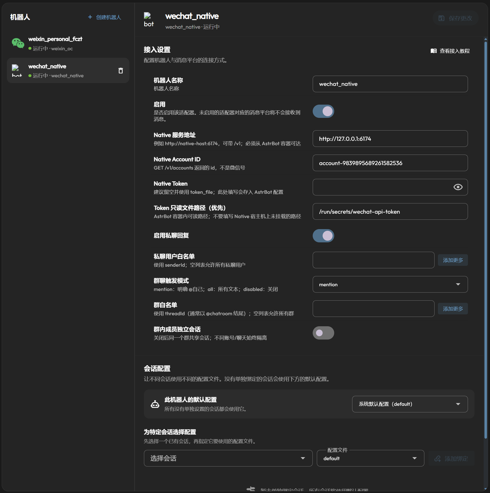

# WeChat Native

让 AstrBot 接入个人微信，在私聊和群聊中使用模型、语音与插件能力。
插件通过 **agent-wechat-native /v1 API** 连接微信，运行于 AstrBot 内，无需额外 Bridge 服务。

**适配版本：** AstrBot `>=4.29.3,<5` · Native `v2.4.0` · Python `3.12+`

[功能概览](#功能概览) · [安装与配置](#安装与配置) · [Docker 部署](#docker-部署同一台-linux-主机) · [常见问题](#常见问题) · [详细用法](docs/features.md)

## 功能概览

### 消息接入与智能回复


图片识别需视觉模型；语音识别与合成需分别配置 STT、TTS。支持 AstrBot 文本转图片，普通文件发送暂不支持。
查看[图片发送](docs/features.md#支持发送图片)、[媒体读取指令](docs/features.md#图片识别)、[语音收发](docs/features.md#微信语音收发)与[引用回复](docs/features.md#消息引用回复)。

[原生表情功能](docs/features.md#原生表情native-v240)支持：
读取引用表情、群聊有效引用自动去重收藏，以及从 Saved/已添加官方表情包发送原生表情。
功能开启后，群内收藏无需管理员、明确请求或 @；视觉问答仍遵守原有唤醒规则。

### 群聊协作与运行保障


群内默认需**真正 @机器人**；摘要、历史工具和微信修改工具需要单独开启。
查看[谁最能聊](docs/features.md#谁最能聊)、[群聊摘要](docs/features.md#群聊摘要)、[聊天工具及权限](docs/features.md#当前聊天工具native-v151)与[循环保护](docs/features.md#自动回复循环保护)。

图示源文件：[消息链路](docs/wechat-native-messages.html) · [群聊与保障](docs/wechat-native-capabilities.html)。

### 面板扫码登录与跨平台断线通知

在插件管理中打开现有 **WeChat Native 面板**，选择已启用的 Native 机器人。
服务可访问且账号未认证时，面板会启动或恢复登录任务，显示 Native 原始二维码；
扫码后按手机提示确认。任务过期或失败后，点击“重新获取二维码”直接重新扫码，
跳过旧会话恢复；首次进入面板仍优先尝试已有设备登录。
已认证但暂时重连的账号不会强制重新扫码。登录需要 Dashboard 管理账号及可读取的
`admin_token_file`，普通连接检测仍使用 `token_file`，无需新增 Secret。

在已经接入 AstrBot 的 Telegram、QQ OneBot、LINE、`weixin_oc` 等平台的**管理员私聊**中操作：

| 中文指令 | 英文指令 | 用途 |
| --- | --- | --- |
| `/绑定通知 [native_bot_id]` | `/bind_alert [native_bot_id]` | 将当前私聊绑定为该 Native 机器人的通知目标 |
| `/解绑通知 [native_bot_id]` | `/unbind_alert [native_bot_id]` | 移除绑定，保留事故状态 |
| `/通知状态 [native_bot_id]` | `/alert_status [native_bot_id]` | 查询最近监测健康、绑定渠道与通知尝试结果 |
| `/测试通知 [native_bot_id]` | `/test_alert [native_bot_id]` | 显式尝试一次测试发送，不改变监控状态 |

只有一个启用的 Native 机器人时可以省略 ID；有多个时必须填写，省略会列出候选 ID。
每个 Native 机器人最多绑定一个私聊，重复绑定可覆盖目标。在哪个平台私聊绑定，就向该私聊通知；
群聊及非管理员不能操作，也不能输入其他人的会话标识来绑定。

后台每 60 秒执行只读检测，与面板是否打开无关。连续 3 次异常进入事故，连续 2 次在线判定恢复。
每次事故最多尝试一次断线通知和一次恢复通知，重启保留状态；发送失败不会自动重试。
没有绑定也监控，但不会发送；后来绑定不会补发已经发生的事件。AstrBot 停机期间无法检测。
通知通过 AstrBot 公共发送接口路由，调用成功不保证最终送达。`weixin_oc` 需要有效上下文，
QQ、LINE 等平台可能限制主动消息；首次使用请运行 `/测试通知` 并在接收端确认。

详见[登录与通知运维说明](docs/operations.md#面板扫码登录与跨平台告警native-v230)
及[自动化验证与真实账号验收](docs/verification-v2.3.0.md)。

## 安装与配置

1. 启动 Native 并登录微信；全新环境见 [Docker 部署](#docker-部署同一台-linux-主机)。
2. 在 AstrBot **插件管理 → 从链接安装**，输入：
   `https://github.com/neozhu/astrbot-plugin-wechat-native`。
3. 在 **机器人 → 新增机器人** 中选择 **WeChat Native**，填写下表并启用。
4. 为机器人选择 AstrBot 配置文件，配置模型和人格，再测试私聊及群 @回复。

参数配置示例（Account ID 和开关以实际使用为准）：



### 连接信息

以下字段填写在 AstrBot 的机器人表单中，**不是 Native 的 server.toml 配置**。

| 字段 | 填写说明 | 本文 Docker 示例 |
| --- | --- | --- |
| `server_url` | AstrBot 能访问的 Native 地址，可带 `/v1` | `http://127.0.0.1:6174` |
| `account_id` | Native 的账号 `id`，从 `wx accounts list` 获取；不是微信号 | 替换为实际 ID |
| `token_file` | Token 文件的**容器内路径**，优先于 `token` | `/run/secrets/wechat-api-token` |
| `token` | 不用文件时先清空 `token_file`，再填写 Native API Token，会保存在 AstrBot 配置里 | 使用文件时留空 |

Native Token 需要目标账号的 **read + send + media** 权限。本文 Compose 让两个容器读取同一份 Token 文件。
模型 API Key 在 AstrBot 的模型设置中配置；更换 Token 文件后重启机器人。

### 回复规则

| 字段 | 默认值 | 说明 |
| --- | --- | --- |
| `enable_private_reply` | `true` | 是否回复私聊 |
| `enable_media` | `true` | 启用图片、PDF 与语音接收；群聊支持引用媒体 + @提问，或先发送再 @并使用读取指令 |
| `enable_stickers` | `false` | 开启原生表情工具及群聊引用自动去重收藏；收藏无需管理员或 @，视觉读取还需 `enable_media` |
| `allowed_users` | `[]` | 私聊 senderId 白名单；空列表允许所有人，不限制群成员 |
| `group_reply_mode` | `mention` | `mention`：真正 @机器人；`all`：全部群文本与直接语音都直接唤醒；`probability`：全部进入 AstrBot，但只有 @ 唤醒，其余交给 AstrBot 的主动回复概率；`disabled`：不回复群聊 |
| `group_reply_style` | `mention` | 群聊回复方式：`mention` @触发者；`quote` 引用触发消息；`plain` 直接发送 |
| `enable_group_red_packet_reply` | `false` | 群红包自动暖场。在允许回复的群里，无需 @，同群 30 秒内最多回复一次 |
| `allowed_groups` | `[]` | 群 threadId 白名单，通常以 `@chatroom` 结尾；空列表允许所有群 |
| `unique_session` | `true` | 同群不同成员独立会话；关闭后同群共享会话 |

用户 ID 和群 ID 可用 Native 的 `wx contacts find 名字`、`wx chats list` 查询。
手打 `@名字` 或仅 @全体不会触发默认群回复。
在 **机器人 → WeChat Native → 群聊回复方式** 下拉框中，可选择 **@触发者 / 引用触发消息 / 直接发送**，默认保留 @触发者。
该设置只控制回复样式，不改变群聊的 @唤醒规则。分段回复仅首段自动 @或引用；纯图片/语音直接发送。
插件或 AstrBot 全局回复装饰已显式添加的 @、引用仍保留；若希望完全由此选项控制，请关闭 AstrBot 全局的“@回复”和“引用回复”。
自动 @所需的群成员资料刷新失败时，会省略该自动 @并继续回复正文；显式 @仍需资料可用。
AstrBot 的模型开关、全局白名单和插件权限仍需正确配置。

图片识别需保持 `enable_media: true`，并为机器人配置支持视觉（Vision）的模型。
如需私聊也默认引用原消息，可在 AstrBot 配置文件中开启 `platform_settings.reply_with_quote`；
引用范围与限制见[消息引用回复](docs/features.md#消息引用回复)。

### 群聊摘要配置

在机器人参数中开启 `enable_group_summary`，保持 `group_reply_mode: mention`。
群内真正 @机器人发送 `总结群聊` 或 `群聊摘要` 即可触发。

| 字段 | 默认值 | 说明 |
| --- | --- | --- |
| `enable_group_summary` | `false` | 开启后在内存缓存允许群的实时文本，供手动生成摘要 |
| `summary_max_messages` | `200` | 每群缓存条数，范围 1–500 |
| `summary_window_minutes` | `60` | 摘要时间范围，单位分钟，范围 1–1440 |

仅收集开启后收到的实时文本；缓存仅在内存中，重启即清空。
生成摘要会将选中的群聊记录发送给当前会话配置的模型。完整范围与限制见[群聊摘要](docs/features.md#群聊摘要)。

### 当前聊天工具配置

| 配置 | 默认值 | 用途 |
|---|---|---|
| `enable_history_tools` | `false` | 开启历史搜索、最近消息、群资料及成员查询 |
| `enable_wechat_actions` | `false` | 开启自身群昵称、群改名及自身消息撤回 |
| `wechat_action_admins` | `[]` | 可改群名/撤回消息的真实 `senderId`；空列表不授权任何人 |
| `admin_token_file` | `/run/secrets/wechat-admin-token` | 既有管理凭据文件；面板扫码登录、群昵称和群改名使用此凭据 |

群昵称/群改名需要单独配置 `admin_token_file`，且 Native Token 具有目标账号的 `admin` scope。
按下方 Docker 示例填写 `/run/secrets/wechat-admin-token`，文件创建、签发及挂载见[管理 Token 步骤](#签发并保存管理-token)。
未配置时这两项返回“权限配置尚未准备好”，不会把原有 read/send Token 升级或用于群管理。
撤回使用原有 read/send 凭据，读工具关闭不影响已授权撤回所需的内部目标读取。
管理工具仅在写功能开启时初始化客户端；面板登录按需读取同一管理凭据。
凭据文件必须挂载到 AstrBot 容器内，勿将 Token 写入版本库。

8 个工具的示例、授权范围与回执处理见[当前聊天工具](docs/features.md#当前聊天工具native-v151)。
这些新增工具尚未使用真实微信账号验证，当前验证使用模拟 Native HTTP 和真实 AstrBot SDK。

### 微信语音收发

要让机器人听懂语音并用语音回复，需要在 AstrBot 中分别配置 **Speech to Text（STT/ASR，语音转文字）**
和 **Text to Speech（TTS，文字转语音）** 服务提供商，并在机器人使用的配置中启用、选择对应服务。
只需要识别收到的语音时，配置 STT 即可；需要将回复合成为语音时，再配置 TTS。

推荐使用作者的两个开源项目，在本地部署语音服务。两者均支持 CPU 运行和 Docker Compose 部署：

| 用途 | 推荐项目 | 接口与配置示例 |
| --- | --- | --- |
| STT：将收到的微信语音转成文字 | [funasr-openai-stt](https://github.com/neozhu/funasr-openai-stt) | 基于 FunASR SenseVoiceSmall，支持中文、英文和中英混合语音。OpenAI 兼容 Base URL 为 `http://<服务地址>:8000/v1`，模型可填 `whisper-1`，API Key 使用服务端 `ASR_API_KEYS` 中配置的密钥。 |
| TTS：将机器人的文字回复合成为语音 | [kokoro-speech-service](https://github.com/neozhu/kokoro-speech-service) | 基于 Kokoro-ONNX，提供 `POST /v1/audio/speech`。Base URL 为 `http://<服务地址>:48731/v1`，API Key 与服务端 `TTS_API_KEY` 一致，音频格式选择 `wav`；音色按服务支持的列表选择，项目默认示例为英文音色 `af_sarah`。 |

1. 按各项目 README 部署服务、下载模型并设置 API Key。
2. 在 AstrBot 中添加 OpenAI 兼容的 STT、TTS 提供商，分别填写上表中的服务地址和密钥。
   在机器人使用的配置中开启语音转文字、文字转语音，并选择刚添加的提供商。
3. TTS 建议设置 `provider_tts_settings.use_file_service: false`，让插件直接读取 AstrBot 生成的本地音频文件。
   先在私聊中发送一条微信语音测试识别，再测试语音回复。

上表端口使用各项目的默认配置。`<服务地址>` 必须能从 AstrBot 访问；Docker 部署时，
`127.0.0.1` 指向 AstrBot 容器自身。采用本文的 host 网络部署时，可用它访问同一主机上的服务。
服务部署在其他容器或主机时，填写可达的容器服务名或主机地址。模型下载和完整参数见对应项目 README。

## Docker 部署：同一台 Linux 主机

需要 Docker Compose 和 OpenSSL。已有部署请在**原 Compose 项目**中修改，保留项目名和数据卷。

两个服务都使用 **host 网络**，因此 AstrBot 可通过 `http://127.0.0.1:6174` 访问 Native，
不配置 `ports`。Native 的默认监听地址也保持为本机地址。

### 1. 准备 Native 配置和 Token

全新部署时先创建工作目录及配置目录：

```bash
mkdir -p wechat-bot
cd wechat-bot
sudo mkdir -p /opt/agent-wechat-native
sudoedit /opt/agent-wechat-native/server.toml
```

在 `server.toml` 中写入：

```toml
schemaVersion = 1
listen = "127.0.0.1:6174"
dataDir = "/var/lib/agent-wechat"
tokenFile = "/run/secrets/wechat-api-token"
```

生成 Token 并设置权限。**已有 Token 会保留，不要覆盖正在使用的凭据。**
Native 容器用户为 UID/GID `10001`；Token 文件保持 `600`，只读挂载。

```bash
sudo sh -c '
  umask 077
  test -f /opt/agent-wechat-native/api-token ||
    openssl rand -hex 32 > /opt/agent-wechat-native/api-token
'
sudo chown 10001:10001 /opt/agent-wechat-native/api-token
sudo chmod 600 /opt/agent-wechat-native/api-token
sudo chmod 644 /opt/agent-wechat-native/server.toml
```

同时准备独立的管理 Token 文件。先创建空文件，待步骤 3 中 Native 启动并创建账号后再签发凭据。
文件必须在启动 Compose 前存在，下面的命令会保留已有内容：

```bash
sudo sh -ec '
  umask 077
  path=/opt/agent-wechat-native/admin-token
  if [ ! -e "$path" ]; then
    : > "$path"
  fi
  test -f "$path"
  chown 10001:10001 "$path"
  chmod 600 "$path"
'
```

### 2. 创建 compose.yaml

```yaml
services:
  astrbot:
    image: soulter/astrbot:latest
    container_name: astrbot
    restart: unless-stopped
    network_mode: host

    environment:
      TZ: Asia/Shanghai

    volumes:
      - astrbot_data:/AstrBot/data
      - /opt/agent-wechat-native/api-token:/run/secrets/wechat-api-token:ro
      - /opt/agent-wechat-native/admin-token:/run/secrets/wechat-admin-token:ro

    logging:
      driver: json-file
      options:
        max-size: "10m"
        max-file: "3"

  agent-wechat:
    image: ghcr.io/thisnick/agent-wechat-native:v2.4.0
    container_name: agent-wechat
    restart: unless-stopped
    network_mode: host
    user: "10001:10001"
    read_only: true

    cap_drop:
      - ALL

    security_opt:
      - no-new-privileges:true

    environment:
      TZ: Asia/Shanghai
      TMPDIR: /var/cache/agent-wechat

    tmpfs:
      - /tmp:rw,noexec,nosuid,size=64m,mode=1777

    volumes:
      - agent_wechat_native_data:/var/lib/agent-wechat
      - agent_wechat_native_scratch:/var/cache/agent-wechat
      - /opt/agent-wechat-native/server.toml:/etc/agent-wechat/server/config.toml:ro
      - /opt/agent-wechat-native/api-token:/run/secrets/wechat-api-token:ro

    stop_grace_period: 30s

volumes:
  astrbot_data:
  agent_wechat_native_data:
  agent_wechat_native_scratch:
```

`astrbot_data` 保存 AstrBot 配置、会话及插件回执，`agent_wechat_native_data` 保存 Native 账号和登录状态；
升级时保留它们。不要用 `docker compose down -v` 删除登录数据。
`agent_wechat_native_scratch` 是临时快照空间，需要预留磁盘容量。
若自行将 AstrBot 改为非 root 用户，还需保证该用户可读挂载的 Token 文件。

### 3. 启动服务并登录微信

```bash
docker compose config --quiet
docker compose up -d
docker compose logs --tail=50 agent-wechat astrbot
```

首次在 Native 容器内登记本机服务，并查询账号：

```bash
docker compose exec agent-wechat wx config server add local --url http://127.0.0.1:6174 --token-file /run/secrets/wechat-api-token
docker compose exec agent-wechat wx --server-name local accounts list
```

没有账号时创建一个，再按提示扫码或在手机确认。已有账号时使用原账号，不要重复创建。

```bash
docker compose exec agent-wechat wx --server-name local accounts create --alias me
docker compose exec agent-wechat wx --server-name local --account me auth login
docker compose exec agent-wechat wx --server-name local accounts list
```

记下返回的账号 `id`。如需使用已有官方微信资料，按
[Native 登录说明](https://github.com/thisnick/agent-wechat/blob/v2.3.0/docs/src/content/docs/setup/connect.mdx)
挂载资料目录；使用期间保持官方客户端关闭。

#### 签发并保存管理 Token

在宿主机安装 Python 3，用于读取 Native CLI 返回的 JSON。将下方 `ACCOUNT_ID` 替换为刚才查询到的
Native 账号 `id`，在 `compose.yaml` 所在目录执行。管理 Token 由 Native 签发并登记，
不能用 `openssl rand` 生成任意字符串来代替。

```bash
ACCOUNT_ID='替换为实际的Native账号ID'

if sudo test -s /opt/agent-wechat-native/admin-token; then
  echo 'admin-token 已存在，保留原凭据'
else
  set -o pipefail
  docker compose exec -T agent-wechat wx --server-name local --json \
    tokens create astrbot-group-admin --accounts "$ACCOUNT_ID" --scopes admin \
    | sudo python3 -c '
import json
import sys
from pathlib import Path

token = json.load(sys.stdin).get("token")
if not isinstance(token, str) or not 32 <= len(token) <= 1024:
    raise SystemExit("Native 未返回有效 Token，文件未写入")
if any(ord(c) < 33 or ord(c) > 126 for c in token):
    raise SystemExit("Token 含非法字符，文件未写入")
path = Path("/opt/agent-wechat-native/admin-token")
if path.stat().st_size:
    raise SystemExit("admin-token 已有内容，未覆盖")
with path.open("w", encoding="ascii") as output:
    output.write(token + "\n")
'
fi

sudo chown 10001:10001 /opt/agent-wechat-native/admin-token
sudo chmod 600 /opt/agent-wechat-native/admin-token
```

脚本只把返回 JSON 的 `token` 字段写入文件，不在终端显示凭据。已有非空文件不会自动重新签发。
查询已登记的 Token 及其账号范围、scopes，可执行：

```bash
docker compose exec agent-wechat wx --server-name local tokens list
```

各项功能需要的 scopes 如下，依据 [Native v2.3.0 Token 文档](https://github.com/thisnick/agent-wechat/blob/v2.3.0/docs/src/content/docs/reference/tokens.mdx)：

| 凭据或功能 | 所需 scopes |
|---|---|
| 日常机器人：历史、群资料、成员、SSE | `read` |
| 日常机器人：文本、图片、语音发送及撤回自身消息 | `send`；撤回目标读取还需要 `read` |
| 日常机器人：图片、语音、PDF 等附件读取 | `media`，并保留 `read` |
| 独立管理 Token：机器人自身群昵称、群改名 | `admin`，限制到当前 Native 账号 |
| 运维 CLI：登录、连接、断开账号 | `login`；本例 CLI 使用已有 owner 凭据 |
| 标记已读 | `read-state`，本插件的新工具不需要 |
| Native 通话 | `calls`，本插件不需要 |

为日常机器人另行签发受限 Token 时，使用 `--scopes read --scopes send --scopes media`。
本部署最初生成的 `api-token` 是 `server.toml` 配置的 owner 凭据，已覆盖这些权限；不要覆盖它来改 scope。
上面的 `admin-token` 是独立签发的凭据。[Native v2.3.0 的 scope 检查](https://github.com/thisnick/agent-wechat/blob/v2.3.0/packages/native-client-rust/crates/wechat-api/src/lib.rs#L98-L108)允许 `admin` 通过其他 scope 的检查，
所以管理 Token 不必再叠加 `read`、`send` 或 `media`。插件仍将日常与群管理请求交给各自客户端。

如果是在已有部署中补充管理文件和挂载，执行以下命令应用 Compose 修改，并确认 AstrBot 可读到非空文件。
检查命令只读取文件大小，不显示 Token：

```bash
docker compose config --quiet
docker compose up -d --force-recreate astrbot
docker compose exec -T astrbot python -c \
  'from pathlib import Path; assert Path("/run/secrets/wechat-admin-token").stat().st_size > 0; print("管理 Token 文件已挂载")'
```

### 4. 配置 AstrBot 机器人

打开 `http://宿主机IP:6185`，按启动日志中的初始凭据登录并修改密码。
安装本插件后，在 WeChat Native 机器人表单中填写：

- `server_url`：`http://127.0.0.1:6174`
- `account_id`：上一步返回的实际账号 ID
- `token_file`：`/run/secrets/wechat-api-token`
- `admin_token_file`：`/run/secrets/wechat-admin-token`
- `token`：留空

需要使用新工具时，继续填写：

- `enable_history_tools`：`true`，启用当前聊天历史和群资料读取。
- `enable_wechat_actions`：`true`，启用群昵称、群改名和自身消息撤回。
- `wechat_action_admins`：管理员真实 `senderId` 列表，例如 `["wxid_admin"]`。群改名和撤回只允许这些账号；空列表不授权任何人。

`api-token` 和 `admin-token` 的宿主机目录都是 `/opt/agent-wechat-native/`，**机器人必须填上面列出的容器内路径**。
这两个路径也是新建机器人表单的默认值；已有配置不会自动覆盖，非 Docker 部署按实际路径填写。
确认 AstrBot 版本符合插件要求，配置好模型并启用机器人。管理面板 6185 仅向管理网络开放，Native 6174 保持本机访问。

### 5. 检查连接

进入 **插件管理 → WeChat Native → 可视化视图 → WeChat Native 面板**：
“已连接”表示 Native API 验证通过；“在线 / 离线”单独表示微信账号状态。
检测不发送消息，也不验证模型和发送权限，最后还需人工测试私聊及群内真正 @回复。

面板提供今日接收、今日已回复、今日失败及全部日期的待核对数量，
并以柱形图显示最近 7 天的接收和已回复消息。统计按机器人独立保存到现有 SQLite 状态库，
重启后保留；从升级后首次启动开始采集，之前日期显示未采集，首日可能不足全天。
按 AstrBot 服务端本地接收日期汇总消息的当前状态，只计实时入站消息，
重放与分段回复不重复计数；部分发送不计为成功回复，归入待核对。
面板每 30 秒自动刷新，后台页面暂停刷新；配置概览可展开查看。

面板预览（以下为示例数据）：


排查网络时，可从 AstrBot 容器执行只读检查，不输出 Token：

```bash
docker compose exec -T astrbot python - <<'PY'
import json
from pathlib import Path
from urllib.request import Request, urlopen

token = Path("/run/secrets/wechat-api-token").read_text().strip()
req = Request("http://127.0.0.1:6174/v1/status",
              headers={"Authorization": "Bearer " + token})
with urlopen(req, timeout=5) as response:
    print("Native 服务状态:", json.load(response).get("state"))
PY
```

### 其他网络环境

- **Windows / macOS Docker Desktop**：本例的 host 网络需先在设置中启用，文件权限也需按宿主环境调整；见 [Docker host 网络说明](https://docs.docker.com/engine/network/drivers/host/)。
- **Native 在另一台主机**：填 AstrBot 实际可达的 HTTPS 地址或加密隧道入口；Token 文件需在 AstrBot 所在主机另行准备并挂载。
- **AstrBot 使用 bridge 网络**：容器里的 `127.0.0.1` 指向它自己。只加入同一网络或增加端口映射，不能让 Native 的 loopback 监听自动对外可达，需提供受保护的可达入口。

跨主机使用 HTTPS 或受保护隧道；反向代理需关闭 SSE 缓冲并允许长连接。

## 常见问题

| 现象 | 检查方法 |
| --- | --- |
| 没有 WeChat Native 类型 | 确认插件启用、AstrBot 版本符合要求，刷新页面或重启 |
| 401 / 403 | 检查 Native Token、账号范围及 read/send/media 权限 |
| Token 文件不可读 | 核对容器内路径、挂载文件是否存在、运行用户权限 |
| 连接拒绝 / 超时 | 从 AstrBot 容器检查地址、网络模式和 Native 是否启动 |
| API 已连接，微信离线 | 在 Native 完成登录或等待账号恢复连接 |
| 在线但不回复 | 检查模型、白名单和群触发模式；历史或超过 5 分钟的消息会被忽略，注意时钟同步 |
| `needs_review` / `partial` | 保留回执，先核对真实聊天；不要自动重发或删除状态库 |
| HTTP 410 / 游标过期 | 停止机器人并备份状态，由管理员核对 Native 事件保留范围 |

插件状态位于 `/AstrBot/data/plugin_data/astrbot_plugin_wechat_native/`。
请保留整个 AstrBot data 目录；发送回执、重启恢复和只读排查见 [运维说明](docs/operations.md)。

## 开发与协议

```bash
python -m pip install -r requirements-dev.txt
python -m playwright install chromium
python -m pytest -q
ruff check .
ruff format --check .
```

使用 Python 3.12 虚拟环境；生产安装由 AstrBot 处理 `requirements.txt`，无需安装开发依赖。

- [AstrBot Docker 部署](https://docs.astrbot.app/deploy/astrbot/docker.html)
- [Native Docker 部署](https://github.com/thisnick/agent-wechat/tree/v2.3.0/deploy/native)
- [Native v2.3.0 API](https://github.com/thisnick/agent-wechat/blob/v2.3.0/docs/src/content/docs/use/api.mdx)

本插件采用 [MIT 许可证](LICENSE)。仅接入有权操作的微信账号。

## 发布源码包

推送到 `main` 分支且 `metadata.yaml` 中的 `version` 变化时，自动打包、创建对应的 `v<版本号>` 标签，
并发布 GitHub Release。仅修改描述等其他元数据不会发布，普通代码推送也不会触发该工作流。
也可在 GitHub **Actions → Package and Release → Run workflow** 手动打包，
完成后从该次运行的 Artifacts 下载源码 ZIP 和 SHA-256 校验文件；在分支上手动运行不会发布 Release。
源码包包含当前提交的 Git 跟踪文件，顶层目录为 `astrbot_plugin_wechat_native/`。

推送与 `metadata.yaml` 版本一致的标签（例如 `v0.3.10`）时，工作流自动创建 GitHub Release
并上传同样的两个文件。已有 Release 的附件会保留，重新运行不会覆盖；标签与版本不一致会停止发布。
自动发布时若版本标签已指向其他提交，也会停止并提示递增版本号，避免复用旧版本。
